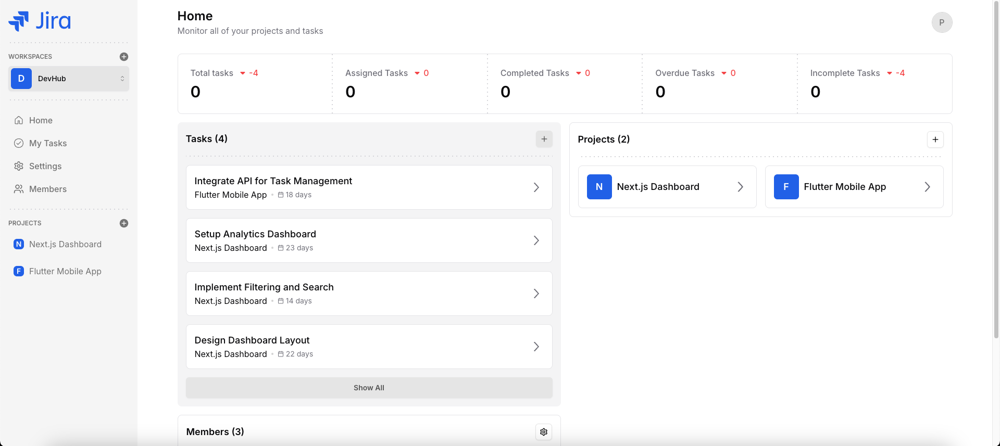
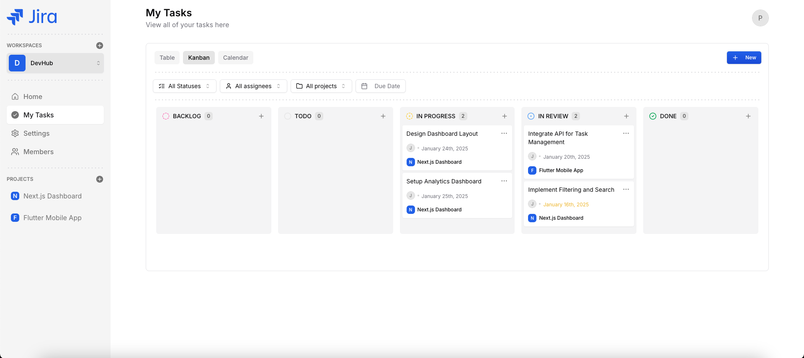
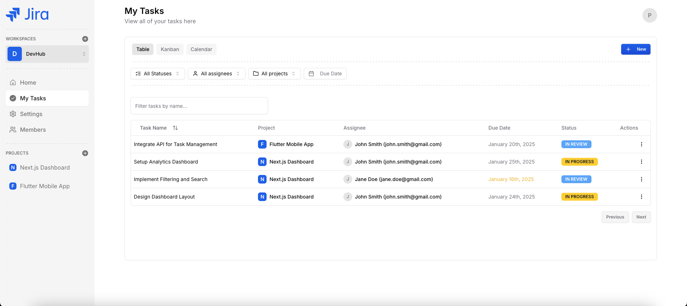
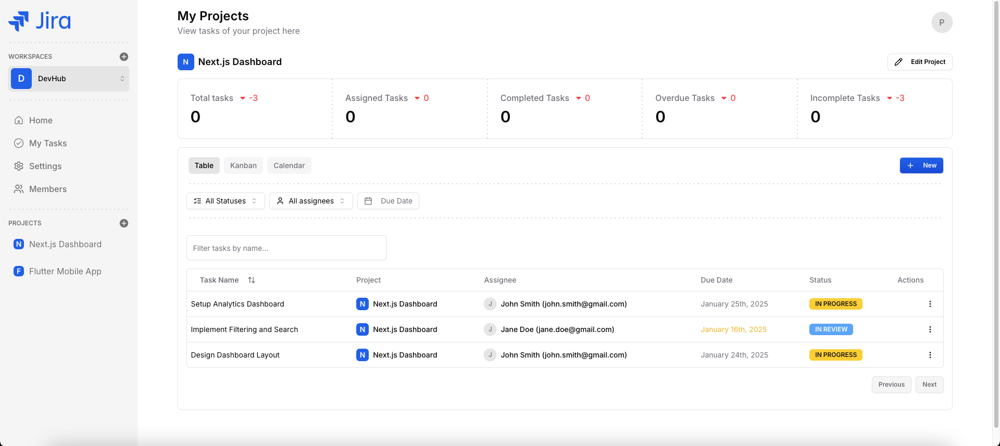

# 🚀 Jira Clone

> Modern project management platform inspired by Jira, built with **Next.js 15**, **TypeScript**, **Appwrite** and **Tailwind CSS**.

## ✨ Features

* 📊 **Kanban boards** with drag & drop
* 📅 **Calendar & table views**
* 📈 **Analytics dashboard**
* 👥 **Team & workspace management**
* 🔐 **Authentication & role-based access**
* ⚡ **Real-time updates**
* 🌙 **Dark / Light mode**
* 📱 **Fully responsive UI**

## 📸 Screenshots

<p align="center">
  
  
</p>

<p align="center">
  
  
</p>

## 🛠️ Tech Stack

* **Next.js 15** + **TypeScript**
* **Tailwind CSS** + **Shadcn/UI**
* **Hono.js**
* **Appwrite**
* **TanStack Query**
* **React Hook Form**
* **Zod**
* **Recharts**
* **Hello Pangea DnD**

## 🚀 Getting Started

### 1. Clone

```bash
git clone https://github.com/H-530/clone_jira.git
cd Jira
```

### 2. Install dependencies

```bash
npm install
```

### 3. Configure environment

```bash
cp .env.example .env
```

Add your Appwrite configuration to `.env`:

```env
NEXT_PUBLIC_APPWRITE_IMAGES_BUCKET_ID=
NEXT_PUBLIC_APPWRITE_PROJECT=
NEXT_PUBLIC_APPWRITE_DATABASE_ID=
NEXT_PUBLIC_APPWRITE_WORKSPACES_ID=
NEXT_PUBLIC_APPWRITE_MEMBERS_ID=
NEXT_PUBLIC_APPWRITE_PROJECTS_ID=
NEXT_PUBLIC_APPWRITE_TASKS_ID=
NEXT_PUBLIC_APPWRITE_KEY=
NEXT_PUBLIC_APP_URL=
NEXT_PUBLIC_APPWRITE_ENDPOINT=https://cloud.appwrite.io/v1
```

### 4. Run the project

```bash
npm run dev
```

Open **http://localhost:3000**

## 📁 Project Structure

```text
src/
├── app/          # Pages & API routes
├── components/   # UI components
├── features/     # Application features
├── hooks/        # Custom hooks
├── lib/          # Utilities
└── types/        # TypeScript types
```

## 📜 Scripts

```bash
npm run dev       # Development
npm run build     # Production build
npm start         # Start production
npm run lint      # Lint
```

## ☁️ Deployment

The project can be deployed easily using **Vercel**.

Configure the required environment variables in your deployment settings.

## 🤝 Contributing

Contributions are welcome!

1. Fork the repository
2. Create a feature branch
3. Commit your changes
4. Push the branch
5. Open a Pull Request

---

<div align="center">

⭐ If you like this project, consider giving it a star!

**using Next.js & Appwrite**

</div>
